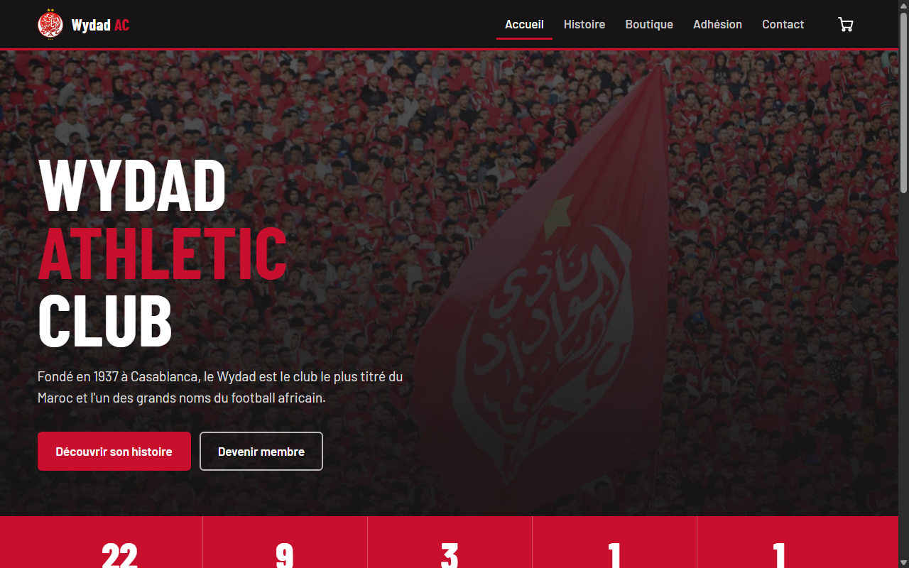
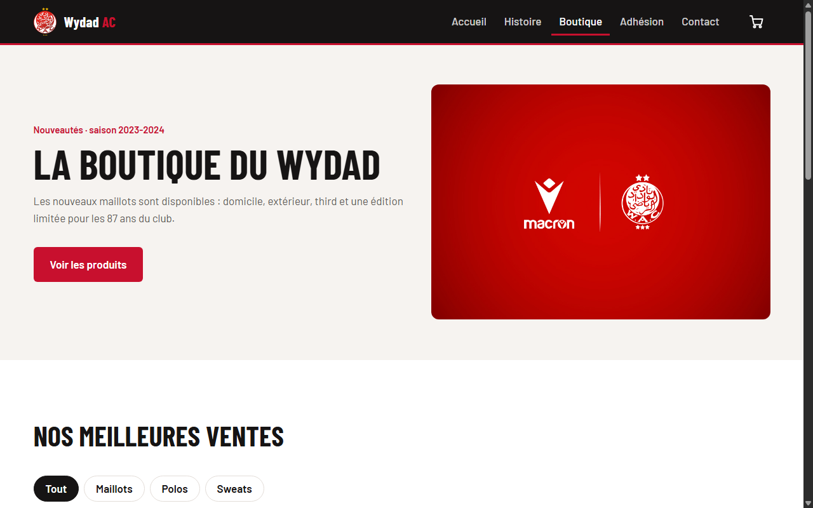
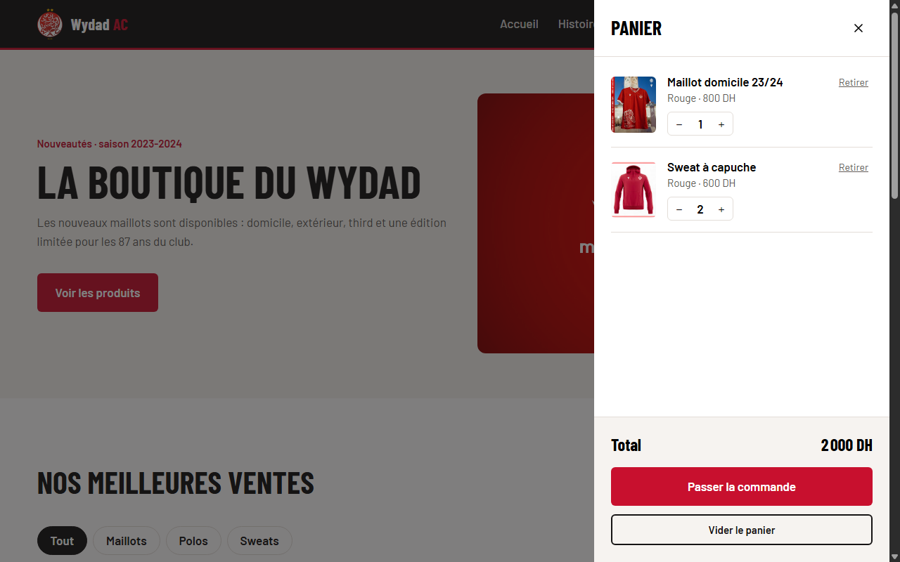
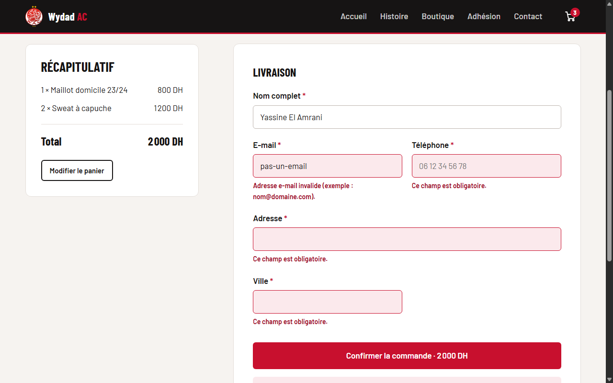
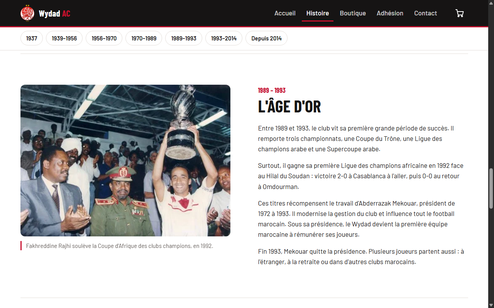
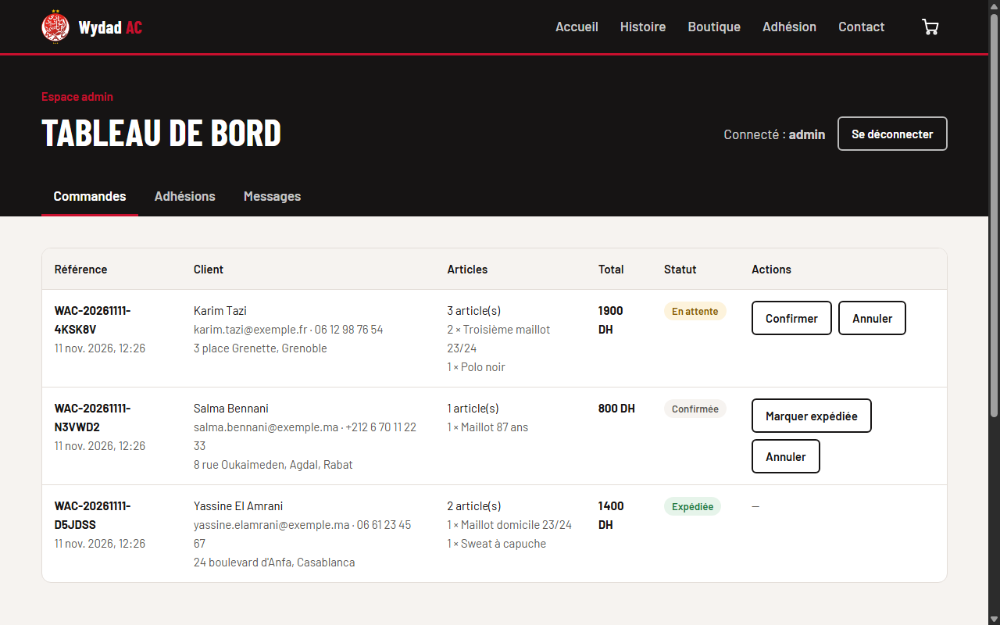
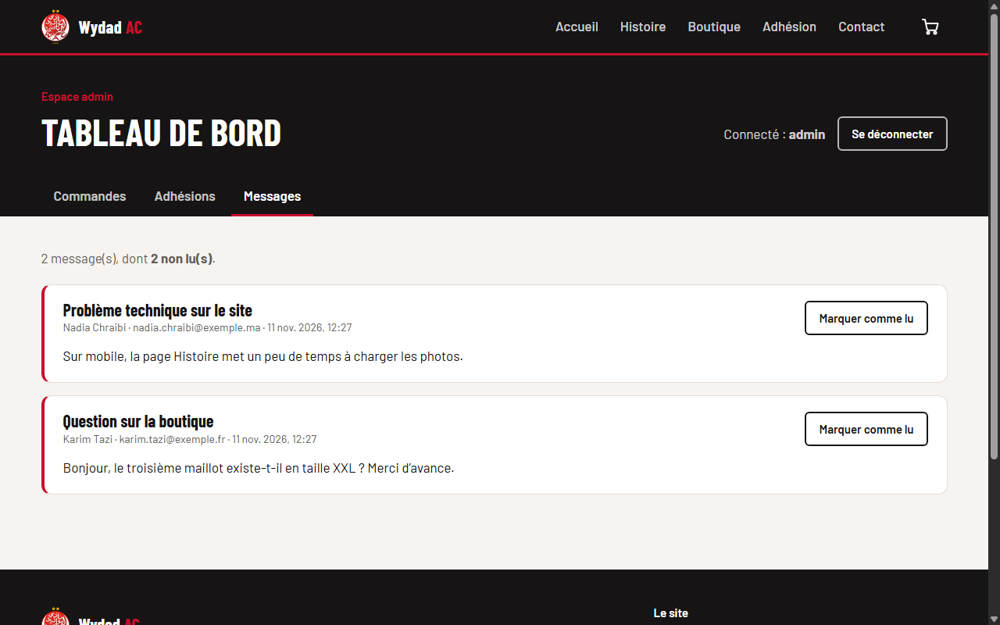
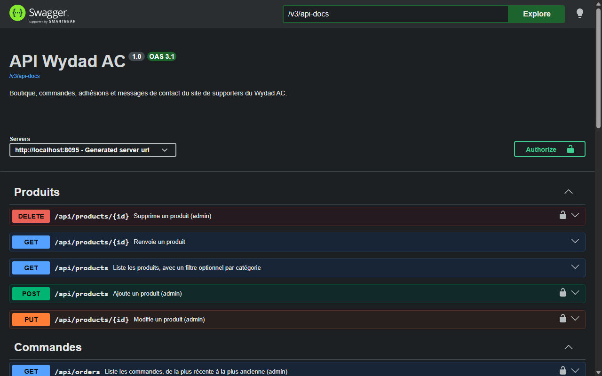
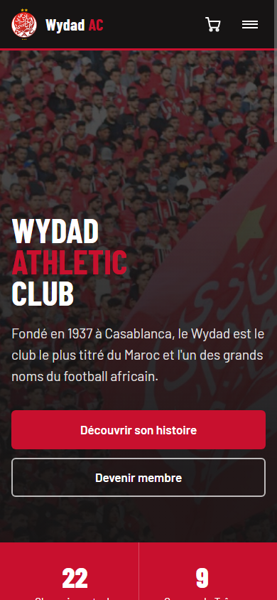
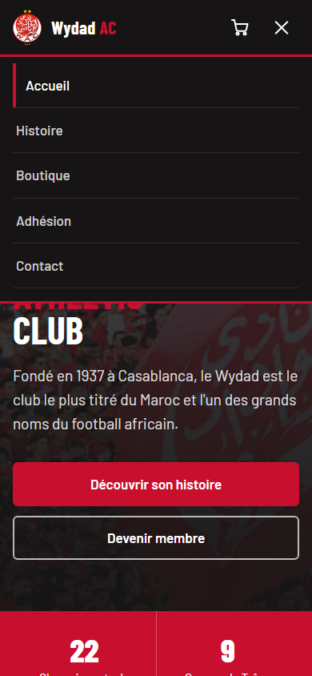

# Wydad AC — site de supporters

Application web complète autour du **Wydad Athletic Club** de Casablanca : histoire du club, boutique avec panier et commandes, adhésion en ligne, formulaire de contact et **espace d'administration**.

**Frontend Angular 22** · **API REST Spring Boot 4** · **PostgreSQL** · **Docker**




---

## Sommaire

- [Fonctionnalités](#fonctionnalités)
- [Captures d'écran](#captures-décran)
- [Architecture](#architecture)
- [Démarrage rapide avec Docker](#démarrage-rapide-avec-docker)
- [Développement local](#développement-local)
- [Tests](#tests)
- [API REST](#api-rest)
- [Choix techniques](#choix-techniques)
- [Structure du projet](#structure-du-projet)
- [Historique du projet](#historique-du-projet)
- [Avertissement](#avertissement)

## Fonctionnalités

**Partie publique**

- **Accueil** : bannière, palmarès en chiffres, accès rapide aux sections.
- **Histoire** : frise chronologique en 7 époques (1937 → aujourd'hui) avec navigation par période.
- **Boutique** : catalogue chargé depuis l'API, filtres par catégorie, panier latéral (quantités, total), panier conservé entre les visites.
- **Commande** : formulaire de livraison, total **recalculé par le serveur**, numéro de commande unique (`WAC-20261111-K7P2QX`).
- **Adhésion** et **Contact** : formulaires validés côté navigateur **et** côté serveur, erreurs affichées sous chaque champ.

**Espace admin** (connexion par JWT)

- **Commandes** : liste détaillée, changement de statut selon des règles métier (en attente → confirmée → expédiée, ou annulée).
- **Adhésions** : filtre par statut, acceptation ou refus des demandes.
- **Messages** : messages reçus, compteur de non-lus, marquage comme lu.

**Qualité**

- Design responsive (mobile, tablette, ordinateur), menu mobile.
- Accessibilité : HTML sémantique, navigation clavier, attributs ARIA, focus sur le premier champ en erreur.
- 64 tests automatisés (33 backend, 31 frontend) et intégration continue GitHub Actions.

## Captures d'écran

| Boutique | Panier |
| --- | --- |
|  |  |

| Commande (validation) | Histoire |
| --- | --- |
|  |  |

| Admin — commandes | Admin — messages |
| --- | --- |
|  |  |

| Documentation de l'API (Swagger) | Mobile |
| --- | --- |
|  |   |

## Architecture

```
 Navigateur
     │
     ▼
 ┌──────────────────────────┐
 │  nginx  (conteneur web)  │  sert l'application Angular
 │  :8088                   │  et relaie /api/** vers l'API
 └────────────┬─────────────┘
              │ /api
              ▼
 ┌──────────────────────────┐
 │  Spring Boot (api)       │  REST · validation · sécurité JWT
 │  :8095                   │  Swagger : /swagger-ui.html
 └────────────┬─────────────┘
              │ JPA / Flyway
              ▼
 ┌──────────────────────────┐
 │  PostgreSQL 17 (db)      │  données persistées dans un volume
 └──────────────────────────┘
```

| Couche | Technologies |
| --- | --- |
| Frontend | Angular 22 (composants standalone, signals, zoneless), TypeScript 6, Reactive Forms, SCSS, Vitest |
| Backend | Java 25, Spring Boot 4.1 (Web MVC, Data JPA, Validation, Security, OAuth2 Resource Server), springdoc-openapi |
| Données | PostgreSQL 17, migrations Flyway, H2 pour les tests |
| Outillage | Docker Compose, Maven Wrapper, GitHub Actions |

## Démarrage rapide avec Docker

Prérequis : [Docker Desktop](https://www.docker.com/products/docker-desktop/).

```bash
git clone https://github.com/<votre-pseudo>/Projet-ClubFoot.git
cd Projet-ClubFoot
docker compose up --build
```

| Service | Adresse |
| --- | --- |
| Site | http://localhost:8088 |
| API (Swagger) | http://localhost:8095/swagger-ui.html |
| PostgreSQL | `localhost:5433` (base `clubfoot`) |

Compte admin de démonstration : **admin / admin123** (lien « Espace admin » en bas de page).

Pour changer les identifiants ou le secret JWT, copier `.env.example` en `.env` et modifier les valeurs.
Pour repartir d'une base vide : `docker compose down -v`.

## Développement local

Prérequis : Java 25, Node.js 24, Docker (pour PostgreSQL).

```bash
# 1. Base de données
docker compose up -d db

# 2. API (http://localhost:8095)
cd backend
./mvnw spring-boot:run

# 3. Frontend (http://localhost:4300), dans un autre terminal
cd frontend
npm install
npm start
```

En développement, Angular relaie les appels `/api` vers `localhost:8095` (voir `frontend/proxy.conf.json`).

## Tests

```bash
cd backend && ./mvnw verify          # 33 tests : JUnit 5, MockMvc, base H2
cd frontend && npx ng test --watch=false   # 31 tests : Vitest
```

Ce qui est testé :

- **API** : catalogue, calcul du total d'une commande, fusion des lignes identiques, transitions de statut, validation des champs (format Problem Details), accès refusé sans jeton, connexion JWT.
- **Frontend** : panier (quantités, total, sauvegarde), validateurs de formulaire, ajout du jeton par l'intercepteur et déconnexion sur 401, page boutique (affichage, filtres, erreur réseau).

## API REST

| Méthode | Route | Accès | Rôle |
| --- | --- | --- | --- |
| `GET` | `/api/products?category=` | public | Catalogue (filtre optionnel) |
| `GET` | `/api/products/{id}` | public | Détail d'un produit |
| `POST` `PUT` `DELETE` | `/api/products[/{id}]` | admin | Gestion du catalogue |
| `POST` | `/api/orders` | public | Passer une commande |
| `GET` | `/api/orders` | admin | Lister les commandes |
| `PATCH` | `/api/orders/{id}/status` | admin | Changer le statut |
| `POST` | `/api/memberships` | public | Demande d'adhésion |
| `GET` | `/api/memberships?status=` | admin | Lister les demandes |
| `PATCH` | `/api/memberships/{id}/status` | admin | Accepter / refuser |
| `POST` | `/api/contact-messages` | public | Envoyer un message |
| `GET` | `/api/contact-messages` | admin | Lister les messages |
| `PATCH` | `/api/contact-messages/{id}/read` | admin | Marquer comme lu |
| `POST` | `/api/auth/login` | public | Obtenir un jeton JWT |

Les erreurs suivent le standard **RFC 9457 (Problem Details)** :

```json
{
  "status": 400,
  "title": "Données invalides",
  "detail": "Certains champs sont invalides.",
  "errors": { "email": "Adresse e-mail invalide." }
}
```

## Choix techniques

**Backend**

- **Organisation par fonctionnalité** (`product`, `order`, `membership`, `contact`, `auth`) : chaque dossier contient son contrôleur, son service, son repository et ses DTO.
- **Le serveur fait foi** : le navigateur n'envoie que des identifiants de produits et des quantités. Les prix viennent de la base, et le total est recalculé côté serveur.
- **Instantané des prix** : une ligne de commande garde le nom et le prix du produit au moment de l'achat.
- **Règles métier dans le domaine** : `OrderStatus.canTransitionTo()` interdit par exemple d'expédier une commande non confirmée.
- **Validation** : Bean Validation sur les DTO (records Java), plus une contrainte personnalisée `@AgeRange`.
- **Sécurité** : API sans état, JWT signé en HS256 via Spring Security OAuth2 Resource Server, mots de passe hachés (BCrypt), CORS configurable.
- **Schéma versionné** avec Flyway ; Hibernate valide le schéma au démarrage (`ddl-auto: validate`).
- **Problème N+1 évité** avec `@EntityGraph` sur les listes de commandes et d'adhésions.

**Frontend**

- **Composants standalone, signals et mode zoneless**, `OnPush` partout, routes chargées à la demande (une page = un fichier JS).
- **Garde de route** pour l'espace admin, **intercepteur HTTP** pour le jeton et l'expiration de session.
- **Formulaires réactifs typés** ; les erreurs renvoyées par l'API s'affichent sous le bon champ.

**Patterns et refactorings** ([Refactoring.Guru](https://refactoring.guru/fr))

| Pattern / refactoring | Où | Pourquoi |
| --- | --- | --- |
| Observer | `CartStore` (signals) | Le badge, le tiroir et la page commande se mettent à jour seuls quand le panier change. |
| Chain of Responsibility | `authInterceptor` | Chaque intercepteur HTTP traite la requête puis la passe au suivant. |
| Strategy | `validators.ts`, `@AgeRange` | Chaque règle de validation est interchangeable et se branche sur n'importe quel champ. |
| Extract Class | `RemoteList` | La logique « chargement / erreur / mise à jour » était dupliquée dans les 3 écrans admin. |
| Introduce Parameter Object | `CustomerDetails` | Regroupe les coordonnées du client au lieu d'un constructeur à 7 paramètres. |

## Structure du projet

```
.
├── backend/                      API Spring Boot
│   ├── src/main/java/com/clubfoot/api/
│   │   ├── auth/                 Connexion et émission du JWT
│   │   ├── common/               Gestion des erreurs, validations communes
│   │   ├── config/               Sécurité, CORS, OpenAPI, propriétés
│   │   ├── contact/              Messages de contact
│   │   ├── membership/           Demandes d'adhésion
│   │   ├── order/                Commandes et lignes de commande
│   │   └── product/              Catalogue
│   ├── src/main/resources/db/migration/   Scripts Flyway
│   └── Dockerfile
├── frontend/                     Application Angular
│   ├── src/app/
│   │   ├── core/                 API, authentification, panier, stockage
│   │   ├── layout/               En-tête, pied de page, tiroir du panier
│   │   ├── pages/                Accueil, histoire, boutique, commande, admin…
│   │   └── shared/               Validateurs, libellés, formatage des prix
│   ├── nginx.conf
│   └── Dockerfile
├── docs/screenshots/
├── .github/workflows/ci.yml      Intégration continue
└── docker-compose.yml
```

## Historique du projet

| Version | Contenu |
| --- | --- |
| **v1** — 1<sup>re</sup> année de MIAGE (Maroc) | Site statique en HTML et CSS : 5 pages, sans interactivité. |
| **v2** — refonte complète | Application Angular, API Spring Boot, base PostgreSQL, espace admin, tests automatisés, Docker et CI. |

## Avertissement

Projet **étudiant et non officiel**, réalisé dans un but pédagogique. Il n'a aucun lien avec le Wydad Athletic Club.
Le logo, les photos et les visuels des produits appartiennent à leurs propriétaires respectifs.
La boutique est une démonstration : aucun paiement n'est demandé et aucune commande n'est livrée.
