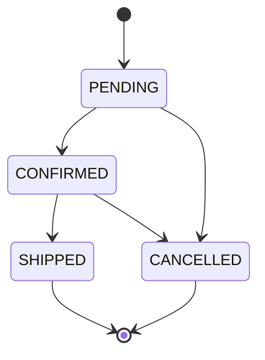

# API REST

Base : `/api`. Format : JSON. Documentation interactive : **http://localhost:8095/swagger-ui.html**.

Les routes marquées **admin** demandent l'en-tête `Authorization: Bearer <jeton>`, obtenu avec `POST /api/auth/login`.

## Authentification

### `POST /api/auth/login`

```json
{ "username": "admin", "password": "admin123" }
```

Réponse `200` :

```json
{ "token": "eyJraWQiOi…", "username": "admin", "expiresAt": "2026-11-11T14:02:00Z" }
```

Mauvais identifiants : `401`.

## Produits

| Méthode | Route | Accès | Réponse |
| --- | --- | --- | --- |
| `GET` | `/api/products` | public | Liste des produits |
| `GET` | `/api/products?category=POLO` | public | Filtre : `JERSEY`, `POLO`, `HOODIE` |
| `GET` | `/api/products/{id}` | public | Un produit, ou `404` |
| `POST` | `/api/products` | admin | `201`, en-tête `Location` |
| `PUT` | `/api/products/{id}` | admin | Produit modifié |
| `DELETE` | `/api/products/{id}` | admin | `204` |

Exemple de produit :

```json
{
  "id": 1,
  "name": "Maillot 87 ans",
  "category": "JERSEY",
  "color": "Rouge royal",
  "price": 800.00,
  "imageUrl": "/images/boutique/maillot-87-ans.jpeg",
  "badge": "Édition limitée"
}
```

## Commandes

### `POST /api/orders` (public)

```json
{
  "fullName": "Yassine El Amrani",
  "email": "yassine.elamrani@exemple.ma",
  "phone": "06 61 23 45 67",
  "address": "24 boulevard d'Anfa",
  "city": "Casablanca",
  "lines": [
    { "productId": 2, "quantity": 1 },
    { "productId": 8, "quantity": 1 }
  ]
}
```

Réponse `201` :

```json
{
  "id": 1,
  "reference": "WAC-20261111-D5JDSS",
  "customerName": "Yassine El Amrani",
  "status": "PENDING",
  "total": 1400.00,
  "createdAt": "2026-11-11T11:26:03Z",
  "lines": [
    { "productId": 2, "productName": "Maillot domicile 23/24", "unitPrice": 800.00, "quantity": 1, "subtotal": 800.00 },
    { "productId": 8, "productName": "Sweat à capuche", "unitPrice": 600.00, "quantity": 1, "subtotal": 600.00 }
  ]
}
```

Le prix n'est jamais envoyé par le client : le total est calculé par le serveur.

| Méthode | Route | Accès | Rôle |
| --- | --- | --- | --- |
| `GET` | `/api/orders` | admin | Toutes les commandes, de la plus récente à la plus ancienne |
| `PATCH` | `/api/orders/{id}/status` | admin | Corps `{ "status": "CONFIRMED" }` |

Transitions autorisées :



Une transition interdite renvoie `400`.

## Adhésions

### `POST /api/memberships` (public)

```json
{
  "fullName": "Salma Bennani",
  "birthDate": "1999-03-21",
  "gender": "FEMALE",
  "email": "salma.bennani@exemple.ma",
  "phone": "+212 6 70 11 22 33",
  "address": "8 rue Oukaimeden, Rabat",
  "country": "Maroc",
  "documents": ["NATIONAL_ID_CARD", "ID_PHOTO"],
  "consent": true
}
```

Valeurs possibles : `gender` = `MALE` ou `FEMALE` ; `documents` = `BIRTH_CERTIFICATE`, `ID_PHOTO` ou `NATIONAL_ID_CARD`.

| Méthode | Route | Accès | Rôle |
| --- | --- | --- | --- |
| `GET` | `/api/memberships?status=PENDING` | admin | Filtre facultatif : `PENDING`, `APPROVED`, `REJECTED` |
| `PATCH` | `/api/memberships/{id}/status` | admin | Corps `{ "status": "APPROVED" }` |

## Messages de contact

### `POST /api/contact-messages` (public)

```json
{
  "name": "Karim Tazi",
  "email": "karim.tazi@exemple.fr",
  "subject": "SHOP",
  "message": "Bonjour, le troisième maillot existe-t-il en taille XXL ?"
}
```

Sujets : `TECHNICAL_ISSUE`, `SHOP`, `MEMBERSHIP`, `OTHER`. Message de 20 à 2000 caractères.

| Méthode | Route | Accès | Rôle |
| --- | --- | --- | --- |
| `GET` | `/api/contact-messages` | admin | Tous les messages |
| `PATCH` | `/api/contact-messages/{id}/read` | admin | Marque le message comme lu |

## Erreurs

Toutes les erreurs suivent le format **Problem Details (RFC 9457)**.

```json
{
  "type": "about:blank",
  "title": "Données invalides",
  "status": 400,
  "detail": "Certains champs sont invalides.",
  "instance": "/api/orders",
  "errors": {
    "email": "Adresse e-mail invalide.",
    "lines[0].quantity": "La quantité minimale est 1."
  }
}
```

| Statut | Cas |
| --- | --- |
| `400` | Champs invalides, produit inconnu, transition de statut interdite |
| `401` | Jeton absent, expiré ou identifiants incorrects |
| `403` | Jeton valide sans le rôle nécessaire |
| `404` | Ressource introuvable |

## Essayer avec curl

```bash
# Liste des polos
curl http://localhost:8095/api/products?category=POLO

# Connexion puis liste des commandes
TOKEN=$(curl -s -X POST http://localhost:8095/api/auth/login \
  -H "Content-Type: application/json" \
  -d '{"username":"admin","password":"admin123"}' | jq -r .token)
curl -H "Authorization: Bearer $TOKEN" http://localhost:8095/api/orders
```
