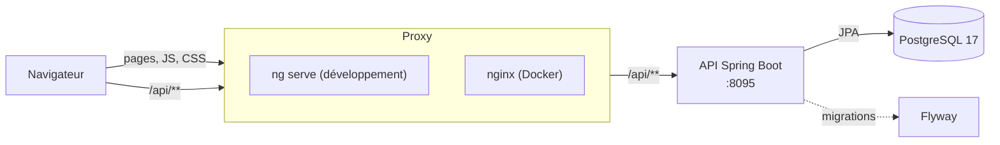
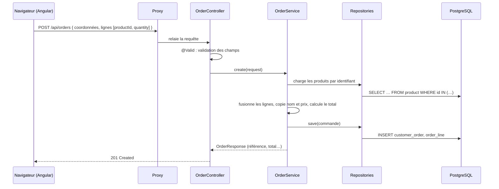
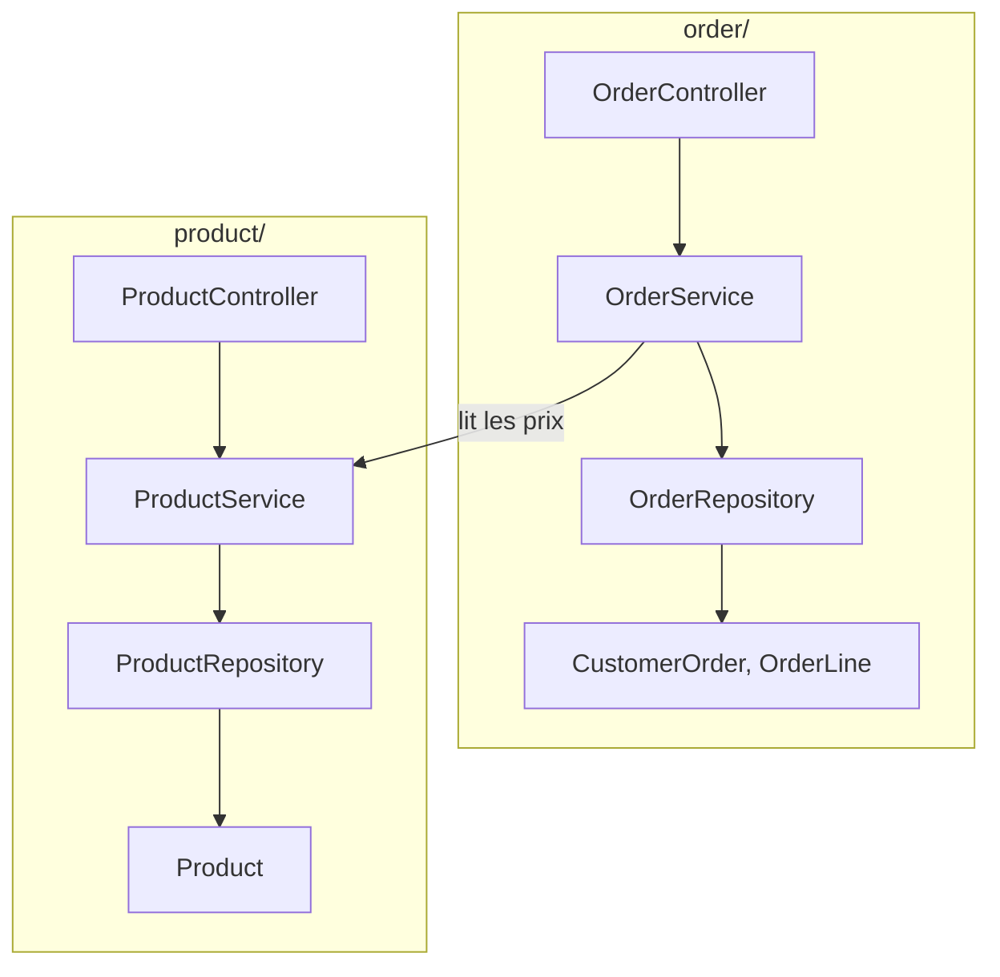

# Architecture

## Vue d'ensemble

L'application suit une **architecture 3-tiers** : présentation (Angular), logique métier (Spring Boot) et données (PostgreSQL).

Le navigateur ne parle **jamais directement** à l'API : toutes les requêtes passent par un **proxy** qui relaie `/api/**` vers le backend. Le site et l'API sont donc vus depuis la même origine, et aucune configuration CORS n'est nécessaire.

| Couche | Technologie | Rôle |
| --- | --- | --- |
| Présentation | Angular 22 | Pages, panier, formulaires, espace admin |
| Proxy | `ng serve` en développement, nginx avec Docker | Sert le site et relaie `/api` vers l'API |
| Logique métier | Spring Boot 4.1 (Java 25) | Règles métier, validation, sécurité JWT |
| Données | PostgreSQL 17 + Flyway | Stockage et versionnage du schéma |

## Parcours d'une requête

Exemple : un visiteur passe une commande.

Le navigateur n'envoie que des **identifiants de produits et des quantités**. Les prix et le total viennent toujours de la base : un utilisateur ne peut pas modifier le prix d'un maillot depuis son navigateur.

## Organisation du code

### Backend : couches et fonctionnalités

Le code est rangé **par fonctionnalité** (un dossier par domaine) et, dans chaque dossier, **par couche** :

| Couche | Responsabilité | Exemple |
| --- | --- | --- |
| Controller | Reçoit la requête HTTP, valide l'entrée, renvoie le code HTTP | `OrderController` |
| Service | Applique les règles métier, gère la transaction | `OrderService` |
| Repository | Lit et écrit en base (Spring Data JPA) | `OrderRepository` |
| Entité | Représente une table, porte les règles propres à l'objet | `CustomerOrder.changeStatus()` |
| DTO | Contrat d'échange avec le client (records Java) | `CreateOrderRequest`, `OrderResponse` |

Une entité n'est jamais renvoyée telle quelle au client : elle passe toujours par un DTO. Le format de l'API reste stable même si la base change.

### Frontend : quatre dossiers

| Dossier | Contenu |
| --- | --- |
| `core/` | Services globaux : appels API, authentification, panier, stockage |
| `layout/` | Éléments présents sur toutes les pages : en-tête, pied de page, tiroir du panier, notification |
| `pages/` | Une page par route, chargée à la demande |
| `shared/` | Outils réutilisables : validateurs, messages d'erreur, libellés, format des prix |

## Choix techniques

| Choix | Pourquoi |
| --- | --- |
| Proxy plutôt que CORS | Une seule origine pour le navigateur : configuration plus simple et plus sûre |
| API sans état + JWT | Pas de session serveur à partager, l'API peut tourner en plusieurs exemplaires |
| Flyway | Le schéma de la base est versionné avec le code ; Hibernate se contente de le valider |
| Records Java pour les DTO | Immuables, concis, validables avec Bean Validation |
| Angular standalone + signals + zoneless | Moins de code, mises à jour d'écran ciblées, pas de zone.js |
| Lazy loading | Chaque page est un fichier JS séparé, la première page charge plus vite |
| Docker Compose | Toute l'application démarre avec une seule commande |

## Patterns et refactorings

Références : [Refactoring.Guru](https://refactoring.guru/fr).

| Nom | Où | Rôle |
| --- | --- | --- |
| Observer | `CartStore` (signals Angular) | Les composants sont prévenus automatiquement quand le panier change |
| Chain of Responsibility | `authInterceptor` | Chaque intercepteur HTTP traite la requête puis la passe au suivant |
| Strategy | `validators.ts`, `@AgeRange` | Des règles de validation interchangeables, branchées sur n'importe quel champ |
| Repository | `*Repository` (Spring Data) | L'accès aux données est isolé derrière une interface |
| Extract Class | `RemoteList` | Logique commune aux trois écrans admin, sortie dans une classe |
| Extract Method | `AgeRangeValidator.isAgeBetween()` | Calcul d'âge pur, testable sans framework |
| Introduce Parameter Object | `CustomerDetails` | Regroupe les coordonnées du client au lieu de sept paramètres |
