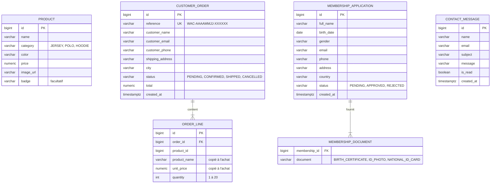

# Backend

API REST en **Java 25** et **Spring Boot 4.1**, dans le dossier [`backend/`](../backend).

## Modules Spring Boot utilisés

| Starter | Utilité |
| --- | --- |
| `spring-boot-starter-webmvc` | Contrôleurs REST |
| `spring-boot-starter-data-jpa` | Accès aux données avec Hibernate |
| `spring-boot-starter-validation` | Validation des requêtes (Bean Validation) |
| `spring-boot-starter-security` + `oauth2-resource-server` | Authentification par jeton JWT |
| `spring-boot-starter-flyway` | Migrations de la base |
| `spring-boot-starter-actuator` | Point de santé `/actuator/health` |
| `springdoc-openapi-starter-webmvc-ui` | Documentation Swagger |

## Packages

```
com.clubfoot.api
├── auth/          Connexion, création du jeton JWT
├── common/        Exceptions, gestion globale des erreurs
│   └── validation/  @AgeRange, format de téléphone
├── config/        Sécurité, OpenAPI, horloge, propriétés typées
├── contact/       Messages de contact
├── membership/    Demandes d'adhésion
├── order/         Commandes et lignes de commande
└── product/       Catalogue
```

Chaque domaine contient son `Controller`, son `Service`, son `Repository`, ses entités et ses DTO (`*Request`, `*Response`).

## Modèle de données



Les lignes de commande gardent le **nom et le prix du produit au moment de l'achat**, pour qu'une commande passée ne change pas si le produit est modifié plus tard. C'est aussi pourquoi `order_line.product_id` n'est pas une clé étrangère.

### Migrations Flyway

| Fichier | Contenu |
| --- | --- |
| `V1__create_schema.sql` | Création des tables, contraintes et index |
| `V2__seed_products.sql` | Les 8 produits de la boutique |

Hibernate est en mode `ddl-auto: validate` : il vérifie au démarrage que les entités correspondent au schéma, sans jamais le modifier. Pour changer la base, on ajoute un fichier `V3__….sql`, sans jamais modifier un fichier déjà appliqué.

## Règles métier

| Règle | Où |
| --- | --- |
| Le total d'une commande est calculé à partir des prix en base | `OrderService.create()` |
| Un même produit envoyé sur deux lignes devient une ligne unique (quantité cumulée, 20 au maximum) | `OrderService.mergeQuantitiesByProduct()` |
| Un produit inconnu dans une commande renvoie une erreur 400 | `OrderService.loadProducts()` |
| Transitions de statut : en attente → confirmée ou annulée, confirmée → expédiée ou annulée, expédiée et annulée sont définitives | `OrderStatus.canTransitionTo()` |
| Référence de commande lisible, sans caractères ambigus (0, O, 1, I) | `OrderReferenceGenerator` |
| Âge d'un membre entre 5 et 110 ans | `@AgeRange` |

## Validation

Les DTO sont des **records Java** annotés avec Bean Validation. Chaque contrainte porte son message en français.

```java
public record ContactMessageRequest(
        @NotBlank(message = "Le nom est obligatoire.") String name,
        @NotBlank @Email(message = "Adresse e-mail invalide.") String email,
        @NotNull(message = "Le sujet est obligatoire.") ContactSubject subject,
        @Size(min = 20, max = 2000, message = "Le message doit contenir entre 20 et 2000 caractères.") String message) {
}
```

Contraintes personnalisées :

- `@AgeRange(min, max)` : vérifie l'âge à partir d'une date de naissance. Le calcul est isolé dans `isAgeBetween()` pour être testé sans framework.
- `PhoneNumber.PATTERN` : accepte `06 12 34 56 78` ou `+212 6 12 34 56 78`. La même règle existe côté Angular.

## Gestion des erreurs

`GlobalExceptionHandler` transforme les exceptions en réponses au format **RFC 9457 (Problem Details)**.

| Exception | Statut | Titre |
| --- | --- | --- |
| `MethodArgumentNotValidException` | 400 | Données invalides, avec le détail par champ dans `errors` |
| `InvalidRequestException` | 400 | Requête invalide |
| `AuthenticationException` | 401 | Authentification refusée |
| `ResourceNotFoundException` | 404 | Ressource introuvable |

## Sécurité

- **API sans état** : pas de session, chaque requête admin porte un jeton `Authorization: Bearer …`.
- **JWT signé en HS256** par `NimbusJwtEncoder` et vérifié par le *resource server* de Spring Security. Le rôle est stocké dans la revendication `roles`.
- **Compte administrateur** défini par configuration (`ADMIN_USERNAME`, `ADMIN_PASSWORD`). Le mot de passe est haché en BCrypt au démarrage.
- **Secret JWT** : 32 caractères au minimum. L'application refuse de démarrer sinon (`JwtProperties`).
- **CSRF désactivé**, car l'API n'utilise pas de cookie.
- **Pas de CORS** : le frontend passe toujours par un proxy, donc par la même origine.

| Accès public | Accès admin (rôle `ADMIN`) |
| --- | --- |
| `GET /api/products/**` | Gestion des produits |
| `POST /api/orders`, `/api/memberships`, `/api/contact-messages` | Lecture et mise à jour des commandes, adhésions et messages |
| `POST /api/auth/login` | |
| Swagger, `/actuator/health` | |

## Configuration

Fichier [`application.yml`](../backend/src/main/resources/application.yml). Chaque valeur peut être remplacée par une variable d'environnement.

| Variable | Valeur par défaut | Rôle |
| --- | --- | --- |
| `SERVER_PORT` | `8095` | Port de l'API |
| `DB_URL` | `jdbc:postgresql://localhost:5433/clubfoot` | Base de données |
| `DB_USERNAME` / `DB_PASSWORD` | `clubfoot` / `clubfoot` | Identifiants de la base |
| `ADMIN_USERNAME` / `ADMIN_PASSWORD` | `admin` / `admin123` | Compte administrateur |
| `JWT_SECRET` | valeur de développement | Clé de signature des jetons |
| `JWT_EXPIRATION` | `PT2H` | Durée de validité d'un jeton (format ISO-8601) |

## Tests

```bash
cd backend
./mvnw verify
```

33 tests, sur une base H2 en mémoire (mode PostgreSQL) migrée par Flyway. Chaque test d'intégration est annulé à la fin (`@Transactional`).

| Classe | Ce qui est vérifié |
| --- | --- |
| `ProductApiTest` | Catalogue, filtre, 404, accès admin pour créer, modifier, supprimer |
| `OrderApiTest` | Calcul du total, fusion des lignes, produit inconnu, validation, transitions |
| `MembershipApiTest` | Création, âge minimum, consentement, filtre par statut |
| `ContactMessageApiTest` | Création, longueur du message, marquage comme lu |
| `AuthApiTest` | Connexion, mauvais mot de passe, champs vides |
| `AgeRangeValidatorTest` | Calcul d'âge, limites, date future |
| `OrderStatusTest` | Toutes les transitions de statut |
