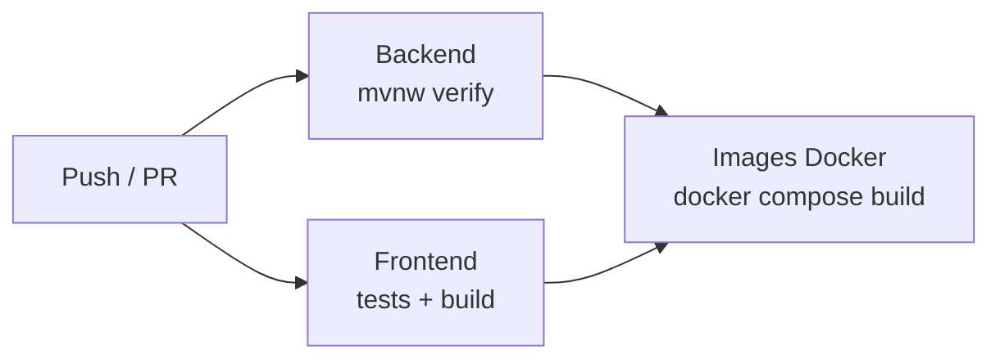

# Déploiement

## Avec Docker Compose

```bash
docker compose up --build
```

| Service | Image | Port sur la machine | Rôle |
| --- | --- | --- | --- |
| `db` | `postgres:17-alpine` | `5433` | Base de données, volume `db-data` |
| `api` | construite depuis `backend/Dockerfile` | `8095` | API Spring Boot |
| `web` | construite depuis `frontend/Dockerfile` | `8088` | nginx : site Angular et proxy `/api` |

L'API attend que la base soit prête (`healthcheck` PostgreSQL et `depends_on: condition: service_healthy`).

Le port `5433` évite le conflit avec un PostgreSQL déjà installé sur la machine.

### Commandes utiles

| Commande | Effet |
| --- | --- |
| `docker compose up -d` | Démarre en arrière-plan |
| `docker compose logs -f api` | Affiche les journaux de l'API |
| `docker compose up -d --build web` | Reconstruit seulement le site |
| `docker compose down` | Arrête tout, en gardant les données |
| `docker compose down -v` | Arrête tout et efface la base |

## Les images Docker

Les deux images sont construites en **deux étapes** (*multi-stage build*) : une étape compile, une autre exécute. L'image finale ne contient pas les outils de compilation.

| Image | Étape 1 | Étape 2 |
| --- | --- | --- |
| `api` | `eclipse-temurin:25-jdk` : `mvnw package` | `eclipse-temurin:25-jre`, utilisateur non root |
| `web` | `node:24-alpine` : `npm ci` puis `npm run build` | `nginx:1.29-alpine` |

## Le proxy

Le navigateur appelle toujours `/api/...` sur l'adresse du site. Le proxy relaie vers l'API.

| Environnement | Proxy | Fichier |
| --- | --- | --- |
| Développement | `ng serve` | [`frontend/proxy.conf.json`](../frontend/proxy.conf.json) |
| Docker / production | nginx | [`frontend/nginx.conf`](../frontend/nginx.conf) |

nginx s'occupe aussi :

- de renvoyer `index.html` pour toute route inconnue, pour que le routeur Angular prenne le relais (`/boutique`, `/admin/commandes`…) ;
- de mettre en cache un an les fichiers JS et CSS, dont le nom est haché à chaque build ;
- de mettre en cache sept jours les images.

## Variables d'environnement

Copier [`.env.example`](../.env.example) en `.env` à la racine. Docker Compose lit ce fichier automatiquement.

| Variable | Défaut | À changer en production |
| --- | --- | --- |
| `DB_PASSWORD` | `clubfoot` | oui |
| `ADMIN_USERNAME` | `admin` | conseillé |
| `ADMIN_PASSWORD` | `admin123` | oui |
| `JWT_SECRET` | valeur de développement | oui, 32 caractères minimum |

Le fichier `.env` est ignoré par git : les secrets ne partent jamais sur GitHub.

## Intégration continue

Le fichier [`.github/workflows/ci.yml`](../.github/workflows/ci.yml) s'exécute à chaque push sur `main` et à chaque pull request.



| Job | Étapes |
| --- | --- |
| Backend | Java 25, cache Maven, `./mvnw -B verify` (compilation et 33 tests) |
| Frontend | Node 24, cache npm, `npm ci`, `ng test`, `npm run build` |
| Images Docker | Construction des deux images, seulement si les deux jobs précédents réussissent |

## Avant une mise en ligne réelle

- [ ] Remplacer `ADMIN_PASSWORD`, `DB_PASSWORD` et `JWT_SECRET`.
- [ ] Servir le site en HTTPS, par exemple derrière un reverse proxy avec un certificat Let's Encrypt.
- [ ] Ne plus exposer les ports `5433` et `8095` : seul nginx doit être joignable.
- [ ] Désactiver Swagger si l'API ne doit pas être documentée publiquement (`springdoc.swagger-ui.enabled=false`).
